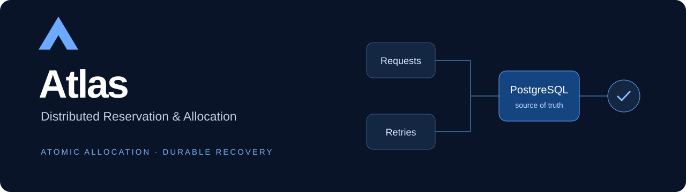
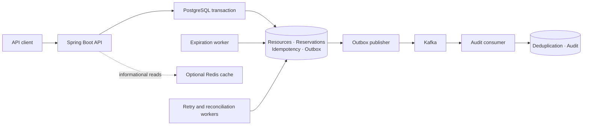
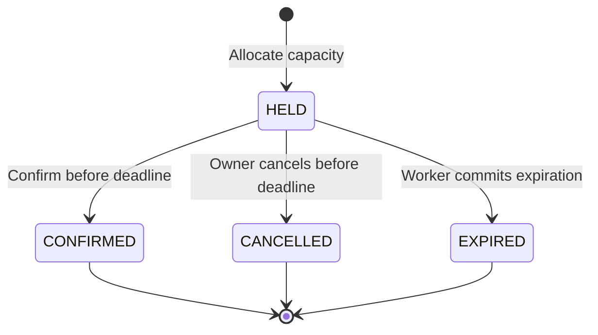

<p align="center"></p>

<p align="center"><strong>Reserve finite capacity safely—even when requests race, responses disappear, and dependencies fail.</strong></p>
<p align="center">Java 21 · Spring Boot 4.1.1 · PostgreSQL · Kafka · Redis · Testcontainers · k6</p>
<p align="center"><a href="#quick-start">Quick start</a> · <a href="docs/APP_API_FLOW.md">API contract</a> · <a href="docs/BACKEND_SCHEMA.md">Schema</a> · <a href="docs/VERIFICATION.md">Verification</a> · <a href="docs/OPERATIONS.md">Operations</a></p>

## The problem

Two customers attempt to reserve the last available place. A client retries after losing the response. A hold expires while another request confirms it. A broker becomes unavailable after the database commits.

Atlas handles these boundaries through PostgreSQL transactions and explicit recovery contracts. It is a backend engineering project for fixed, single-resource capacity: seats, appointment slots, equipment or inventory units. It does not implement payments, airline integrations or a production booking business.

## What Atlas guarantees

| Boundary | Mechanism |
| --- | --- |
| Concurrent allocation | An atomic conditional decrement and reservation insert share one transaction. Capacity cannot be overallocated. |
| Duplicate mutation requests | Caller/operation-scoped idempotency keys replay the original response; mismatched payloads conflict. |
| Confirmation, cancellation and expiration | Reservation locks protect legal transitions. Cancellation/expiration releases capacity once; confirmation keeps it allocated. |
| Committed changes during a Kafka outage | Events are persisted in the transactional outbox before independent publication. |
| Duplicate event delivery | Consumer deduplication and audit effects commit together in PostgreSQL. Delivery is at least once. |
| Redis outages | Informational reads fall back to PostgreSQL. Cache contents never authorize allocation. |
| Failed background work | Bounded retries, guarded operator replay and read-only reconciliation expose durable recovery state. |

The central invariant is:

```text
available capacity + allocated HELD/CONFIRMED quantity = total capacity
```

An overdue hold remains allocated until its expiration transaction commits. Redis availability is informational, and successful HTTP mutation does not imply an event has already reached Kafka.

## Architecture



PostgreSQL owns correctness. Kafka carries durable events to an audit projection. Redis reduces read work with finite TTLs and post-commit invalidation. Neither optional dependency is required for core reservation mutations.

## Quick start

Install **JDK 21**, **Docker with a running Linux engine**, and **Docker Compose**. The Maven wrapper supplies Maven 3.9.11. The first run downloads dependencies and pinned images.

```powershell
git clone https://github.com/mang-os/atlas.git
cd atlas
.\mvnw.cmd -B -ntp verify
Copy-Item .env.example .env
```

Set `POSTGRES_PASSWORD`, `ATLAS_LOCAL_ALICE_PASSWORD`, `ATLAS_LOCAL_BOB_PASSWORD` and `ATLAS_LOCAL_ADMIN_PASSWORD` privately in `.env`. Then:

```powershell
docker compose up -d --wait postgres
docker compose --profile app up -d --build app
curl.exe http://localhost:8080/actuator/health
```

Wait for health to return `UP` before making requests. On Linux/macOS, build with `./mvnw -B -ntp verify` and copy the template with `cp .env.example .env`. The Dockerfile consumes the built JAR, so build before starting the application container.

Kafka and Redis are opt-in. For configuration, bounded readiness checks, host-JVM startup and the Windows Java socket workaround, see [Operations](docs/OPERATIONS.md).

## API at a glance

Local development authentication uses HTTP Basic: `admin` can create resources; `alice` and `bob` operate on their own reservations. Every mutation requires an `Idempotency-Key`.

| Method | Endpoint | Purpose |
| --- | --- | --- |
| POST | `/api/resources` | Create capacity; ADMIN required |
| GET | `/api/resources/{id}` | Read a resource |
| GET | `/api/resources/{id}/availability` | Read informational availability |
| POST | `/api/reservations` | Create an owned temporary hold |
| GET | `/api/reservations/{id}` | Read an owned reservation |
| GET | `/api/users/{userId}/reservations` | List the caller's reservations |
| POST | `/api/reservations/{id}/confirm` | Confirm before the deadline |
| POST | `/api/reservations/{id}/cancel` | Cancel a held reservation |

```bash
# Prompts for the local admin password; reuse the key for matching retries.
curl --user admin --request POST http://localhost:8080/api/resources \
  --header 'Content-Type: application/json' \
  --header 'Idempotency-Key: create-capacity-001' \
  --data '{"name":"Appointment slots","totalCapacity":10}'

# Substitute the returned resource UUID; prompts for Alice's password.
curl --user alice --request POST http://localhost:8080/api/reservations \
  --header 'Content-Type: application/json' \
  --header 'Idempotency-Key: hold-001' \
  --data '{"resourceId":"RESOURCE_UUID","quantity":1}'
```

Matching retries return the stored status/body/Location and `Idempotency-Replayed: true`. Insufficient capacity returns `409`; another owner's reservation is not disclosed. See the [full API contract](docs/APP_API_FLOW.md) and [runnable PowerShell examples](docs/OPERATIONS.md#api-examples).

## Reservation lifecycle



Default hold duration is five minutes. Confirmed reservations retain capacity and cannot be cancelled in this version. Terminal transitions are protected from duplicate capacity release.

## Verification

The retained final local run passed **345 integration tests and 92 unit tests**, with zero failures, errors or skips. Integration tests exercise real PostgreSQL, Kafka and Redis through Testcontainers.

- Capacity 10 under 100 concurrent requests: exactly 10 successful holds, 90 conflicts, zero remaining capacity.
- Duplicate requests, rollback, restart, expired-hold races and commit/acknowledgment failure windows.
- Eight infrastructure failure/recovery scenarios.
- Five measured k6 workloads: 3,769 requests, 557 expected capacity conflicts and zero unexpected failures under the recorded local configuration.

These are local results, not production throughput or availability guarantees. [Verification details and machine-readable summaries](docs/VERIFICATION.md) explain the scope and reproduction commands. GitHub Actions runs the complete Maven verification suite on pushes and pull requests; a hosted result is separate from the retained local run.

## Explore the repository

| Path | Contents |
| --- | --- |
| [src/main](src/main) | API, allocation, lifecycle, idempotency, messaging, caching and recovery |
| [src/test](src/test) | Unit and real-infrastructure integration tests |
| [docs/BACKEND_SCHEMA.md](docs/BACKEND_SCHEMA.md) | Migrations, constraints, indexes and transaction boundaries |
| [docs/OPERATIONS.md](docs/OPERATIONS.md) | Startup, configuration, diagnosis and controlled recovery |
| [scripts/handoff](scripts/handoff) | Isolated startup and failure/recovery demonstration |
| [scripts/load](scripts/load) | Reproducible k6 smoke/measured workloads |
| [flight-demo](flight-demo) | Optional local flight-booking interface over the real API |
| [docs/LEARNING_GUIDE.md](docs/LEARNING_GUIDE.md) | Mechanism explanations, interview questions and contribution boundaries |

Planning: [PRD](docs/PRD.md) · [TRD](docs/TRD.md) · [API flow](docs/APP_API_FLOW.md) · [Developer interface](docs/DEVELOPER_INTERFACE_BRIEF.md) · [Implementation plan](docs/IMPLEMENTATION_PLAN.md).

## Scope and limitations

Atlas is a local portfolio implementation, **not production-ready**. Production authentication/TLS, HA, backups, retention, tracing and operational dashboards remain outside the verified scope. The current Kafka configuration uses a single partition; transport is at least once, cache reads may be stale, and idempotency records are retained indefinitely. Existing-history migration guards must be reviewed before upgrading a populated database.

The implementation was developed with substantial Codex assistance. The learning guide distinguishes generated implementation/evidence from personal review and understanding. See [contributing](CONTRIBUTING.md) and [security](SECURITY.md).
