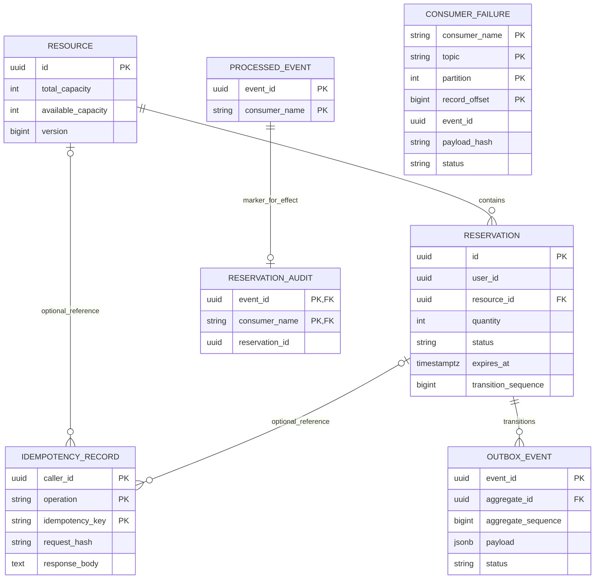

# Atlas - Backend Schema and Invariants

Current schema is Flyway V1-V5, verified on PostgreSQL 17.11. Tables below include the final local v1 contract; phase-boundary paragraphs document historical rollout. [Final review](VERIFICATION.md#phase-15) and [startup/recovery](../README.md). There are no JPA entity mappings or schema generation; persistence uses JDBC snapshots separated from API DTOs.

## General conventions

PostgreSQL is the source of truth [U/S]. UUID primary keys are generated server-side. All timestamps are TIMESTAMPTZ in UTC. Required fields are NOT NULL unless explicitly nullable. Quantities/capacities use INTEGER, counters/sequences use BIGINT where noted. Aggregate sums use PostgreSQL's widened SUM result to avoid integer overflow. Resource and reservation history is retained; no cascading business deletion.

An immutable configured principal UUID is stored as `user_id`/`caller_id`; there is no users table in this local identity model. Accordingly, these are not foreign keys. The service validates identity. A future identity-provider migration must preserve stable IDs and handle existing ownership explicitly.

## resource (Phase 2)

| Column | Type | Constraint/meaning |
| --- | --- | --- |
| id | UUID | Primary key |
| name | VARCHAR(120) | Trimmed, nonempty, length 1-120; not unique |
| total_capacity | INTEGER | > 0; immutable in v1 |
| available_capacity | INTEGER | >= 0 and <= total_capacity |
| version | BIGINT | >= 0, starts at 0; increment on capacity mutation |
| created_at | TIMESTAMPTZ | Database-derived creation time |
| updated_at | TIMESTAMPTZ | Database-derived last mutation time |

Use PK index for allocation and lookup. No unnecessary name index until search exists. A native conditional decrement increments version and updated_at; releases do likewise. A version column does not replace the atomic capacity predicate. Never update available capacity from a detached stale entity.

## reservation (Phase 2; transition_sequence implemented in Phase 9)

| Column | Type | Constraint/meaning |
| --- | --- | --- |
| id | UUID | Primary key |
| user_id | UUID | Immutable authenticated owner |
| resource_id | UUID | FK resource(id), ON DELETE RESTRICT; immutable |
| quantity | INTEGER | > 0; immutable |
| status | VARCHAR(16) | HELD, CONFIRMED, CANCELLED, EXPIRED only |
| expires_at | TIMESTAMPTZ | > created_at, immutable hold deadline |
| confirmed_at | TIMESTAMPTZ nullable | Present exactly for CONFIRMED |
| cancelled_at | TIMESTAMPTZ nullable | Present exactly for CANCELLED |
| expired_at | TIMESTAMPTZ nullable | Added for explicit expiry audit; present exactly for EXPIRED |
| created_at | TIMESTAMPTZ | Hold creation time |
| updated_at | TIMESTAMPTZ | Last state mutation |
| transition_sequence | BIGINT | Phase 9: HELD=1, terminal=2 |

Database CHECK enforces status membership and matching terminal timestamp nullability: HELD has all terminal timestamps null; each terminal state has only its matching timestamp populated. Temporal checks require confirm/cancel timestamps >= created_at and < expires_at; expired_at >= expires_at. Avoid a universal updated_at >= created_at constraint that depends on a perfectly monotonic wall clock. DB clocks must be operated sanely; clock jumps are a documented limitation.

Indexes: `(user_id,created_at,id)` for scoped pagination; `(resource_id,status)` for invariant checks; partial `(expires_at,id) WHERE status='HELD'` for candidate discovery. FK child lookup is supported by resource_id-leading index.

Quantity <= resource capacity, ownership, immutable fields, legal old-to-new status transitions, and capacity restoration exactly once require transactional application logic. CHECK constraints validate a row's resulting values, not its full history or sums across other rows. Direct ad hoc DB writes can violate cross-row invariants; the application DB role and migration access must be separately controlled.

## Phase 2 implementation boundary

V1 uses database `gen_random_uuid()` defaults for IDs, `statement_timestamp()` defaults for creation/update timestamps, and version default 0. Defaults apply on insertion only. Later service transactions must explicitly maintain updated_at/version; they must sample `clock_timestamp()` after locks for deadline decisions. A default is not a trigger or a post-lock clock policy. The name CHECK rejects empty strings and leading/trailing PostgreSQL `[[:space:]]` characters (including ordinary spaces, tabs and newlines); interior spaces and duplicate names are valid.

Internal `Resource` and `Reservation` Java records use UUID and Instant and are immutable snapshots, not API request/response classes or JPA entities. `ReservationStatus.canTransitionTo` describes only HELD -> CONFIRMED/CANCELLED/EXPIRED; same-state calls are not transitions. Later services decide repeated-command semantics. At Phase 2 no repositories, entity adapters, controllers or DTOs existed. Phase 3 now adds a JDBC resource repository and dedicated request/response DTOs with explicit mapping; Phase 4 now adds reservation JDBC persistence, dedicated DTOs and owner-scoped reads; Phase 6 adds locked confirmation/cancellation; Phase 7 adds database-backed expiration. JPA starts with `ddl-auto=validate`, but there are no entity mappings to claim ORM/table mapping verification for in this phase.

| Enforced by PostgreSQL constraints | Enforced by current transactional application logic |
| --- | --- |
| UUID primary-key uniqueness and required columns | Authenticated owner, immutable IDs/owner/resource/quantity/deadline/total capacity |
| Positive total capacity/quantity; 0 <= available <= total; version >= 0 | Quantity <= resource capacity and conservation across all rows |
| Reservation resource FK and ON DELETE RESTRICT | Supported deletion/history-retention policy; direct SQL can still delete child rows |
| Four status values and exactly matching terminal timestamp shape | Legal old-to-new transitions; creation always HELD; terminal states never transition again |
| Deadline after creation; confirm/cancel >= creation and < deadline; expired_at >= deadline | Post-lock DB decision time; deadline eligibility; exactly-once release and confirmation retaining capacity |
| Name length/edge whitespace and column types | DTO validation/mapping; updating version and updated_at with mutations |

No cross-table or lifecycle triggers were added. SchemaIT deliberately demonstrates that an ad hoc CONFIRMED -> HELD rewrite and quantity above capacity can satisfy row constraints while violating the application contract. That test is rolled back and is evidence of the boundary, not permission for application code to do this. The rollback test proves PostgreSQL can undo a capacity change and failed insert in one transaction; that historical schema test did not implement the allocation service or prove concurrency safety. Phase 4 now tests the actual service transaction and injected insertion rollback, and Phase 5 now verifies concurrent allocation with real PostgreSQL (see [evidence](VERIFICATION.md#phase-5)).

## Phase 4 application enforcement now present

Hold creation binds the owner to authenticated principal UUID and atomically decrements available capacity with insertion of a HELD row. Positive API quantity and the conditional UPDATE imply quantity<=available<=total. Capacity/version/timestamp and the new reservation share one commit/rollback; no reservation can be inserted by this API without successful allocation. Creation defaults preserve ID generation and explicitly sets DB-derived hold timestamps. Owned GET/list queries include user_id; listing also rejects a foreign path user UUID. API requests cannot set ID/owner/state/deadline directly; Phase 6 adds the dedicated confirm/cancel commands.

Phase 6 now enforces HELD-to-CONFIRMED/CANCELLED transitions and one-time cancellation release through application transactions; Phase 7 now adds HELD-to-EXPIRED and its atomic release. Direct ad hoc SQL can still violate history/conservation. All persisted HELD rows count, even overdue ones. Actual sequential conservation and rollback checks are in [Phase 4 evidence](VERIFICATION.md#phase-4), not a concurrent stress claim. V1 is unchanged.

## Capacity and lock contract

For a committed consistent snapshot:

`available_capacity + held_quantity + confirmed_quantity = total_capacity`

Count every persisted HELD row regardless of deadline. CANCELLED/EXPIRED quantities contribute zero. Confirmation contributes through CONFIRMED without another decrement. A cancellation/expiration updates the locked HELD row and adds quantity back in one transaction. A failed upper-bound CHECK during release indicates corruption or a bug and must roll back, not clamp values.

Lock order: idempotency claim, one existing reservation, its resource, newly inserted outbox. Holds update resource and insert a new reservation; they never lock an existing one. Workers use one reservation per transaction. Reconciliation snapshot reads do not acquire resource locks and then try to transition existing reservations.

## idempotency_record (Phase 8 implemented)

| Column | Type | Constraint/meaning |
| --- | --- | --- |
| caller_id | UUID | Authenticated caller |
| operation | VARCHAR(64) | e.g. v1.reservation.create/confirm/cancel or v1.resource.create |
| idempotency_key | VARCHAR(128) | Validated opaque key |
| request_hash | CHAR(64) | Lowercase SHA-256 canonical request digest |
| response_status | SMALLINT nullable until completion | Stored final 2xx/eligible 4xx |
| response_body | TEXT nullable until completion | Exact serialized UTF-8 JSON text; JSONB would not preserve bytes |
| response_content_type | VARCHAR(100) nullable until completion | application/json |
| response_location | TEXT nullable | Original Location when applicable |
| reservation_id | UUID nullable | FK reservation(id), RESTRICT |
| resource_id | UUID nullable | FK resource(id), RESTRICT |
| created_at | TIMESTAMPTZ | Claim time |
| completed_at | TIMESTAMPTZ nullable until completion | Response completion |

Composite primary key `(caller_id,operation,idempotency_key)` is the race arbiter. Nullable response fields allow an in-transaction claim; application logic must never commit a claim without a completed response. A CHECK can enforce response fields are all absent or all populated, but cannot alone prevent committing the absent case. Phase 8 tests incomplete committed claims and detects them through IdempotencyHealthIndicator; treat any found as corruption requiring investigation. No separate in-progress commit, Redis lock, or JVM lock.

V2 checks exactly the four v1 operation names, key length/alphabet, lowercase 64-digit hash, and either an entirely empty claim response or a complete response (status 200/201/404/409, body, application/json content type, completed_at). Location and resource/reservation references are null on an incomplete claim. Successes store their returned IDs; domain failures store null references. A failed request may refer to a nonexistent row, so its canonical digest is authoritative. Foreign keys restrict referenced-row deletion; partial indexes on resource_id/reservation_id support those checks. The partial `idempotency_incomplete_idx` supports health detection.

Database checks enforce uniqueness and stored-row shape, not authentication, correct canonicalization, response fidelity, conservation or atomic application completion. Tests exercise fresh V1+V2, V1-to-V2 upgrade retaining existing holds, duplicate scopes, invalid fields/partial responses, references, and application rollback. No historical idempotency is fabricated for requests made before V2. Their original results cannot be recovered with a newly supplied key.

Full records are retained indefinitely. There is no expiry index or cleanup worker in v1. Responses can contain user-linked data; restrict DB access and avoid body logging. If retention changes, define replay expiry, claim/delete concurrency, and privacy requirements first.

## outbox_event (Phase 9 implemented; retry enrichment Phase 12)

| Column | Type | Constraint/meaning |
| --- | --- | --- |
| event_id | UUID | Primary key, stable across retries and replay |
| aggregate_id | UUID | FK reservation(id), RESTRICT |
| aggregate_type | VARCHAR(32) | RESERVATION |
| aggregate_sequence | BIGINT | > 0; unique with aggregate_id |
| event_type | VARCHAR(64) | ReservationHeld/Confirmed/Cancelled/Expired |
| schema_version | INTEGER | Exactly 1 in V3; new versions require a reviewed migration |
| payload | JSONB | Immutable versioned envelope including event_id and sequence |
| status | VARCHAR(16) | PENDING, PUBLISHED; FAILED added for Phase 12 |
| attempt_count | INTEGER | >= 0, recorded failures/attempt accounting |
| next_attempt_at | TIMESTAMPTZ | Next due time |
| created_at | TIMESTAMPTZ | Transition's database decision time |
| published_at | TIMESTAMPTZ nullable | Present only for PUBLISHED |
| last_error | TEXT nullable | Maximum 1024 characters; null in Phase 9 |
| replay_count | INTEGER | Phase 12, >= 0 |
| last_replayed_at | TIMESTAMPTZ nullable | Phase 12, operational audit |
| last_replay_reason | VARCHAR(32) nullable | Phase 12, explicit operator reason |

Partial index `(next_attempt_at,created_at,event_id) WHERE status='PENDING'`; unique `(aggregate_id,aggregate_sequence)`. Constraints tie event type to permitted sequence (held=1, terminal=2) and publication status to published_at. Envelope/table consistency is validated by application tests. No PROCESSING lease is needed for the chosen one-row transaction-lock publisher. Abandoned transactions roll back; long-lived active locks require bounded timeouts and monitoring.

Phase 9 upgrade policy: phases so far are local and no historical event guarantee has existed. Inventory existing rows before migration. Require an empty reservation dataset for enabling the complete event history contract, or block and design an explicit historical import. Do not fabricate past transition events for old rows. Reset only a disposable, explicitly identified development/test database with authorization; preserve non-disposable data. From activation onward, sequence 1 and terminal sequence 2 are obligatory.

## processed_event and reservation_audit (Phase 10)

`processed_event`: event_id UUID, consumer_name VARCHAR(100), processed_at TIMESTAMPTZ; composite PK `(event_id,consumer_name)`. No FK to the producer's outbox, preserving transport/consumer separation.

`reservation_audit`: event_id UUID, consumer_name VARCHAR(100), reservation_id UUID, aggregate_sequence BIGINT > 0, event_type VARCHAR(64), payload JSONB, applied_at TIMESTAMPTZ; composite PK `(event_id,consumer_name)`, FK that pair to processed_event. No producer reservation FK is needed for a downstream audit ledger. Index `(reservation_id,aggregate_sequence)` for inspection. This is the demonstrable business effect, separate from the dedupe marker.

Inside one transaction, insert marker with ON CONFLICT DO NOTHING. Only an insert winner writes the audit effect. Any effect failure rolls back the marker. A duplicate skips the effect and can be acknowledged after the transaction completes. This proves one committed database effect, not exactly-once Kafka delivery or exactly-once external email.

## consumer_failure (Phase 12)

Columns: consumer_name VARCHAR(100), topic VARCHAR(255), partition INTEGER >= 0, record_offset BIGINT >= 0, event_id UUID nullable, payload_hash VARCHAR(64) (lowercase SHA-256), attempt_count INTEGER >= 0, status VARCHAR(16) in RETRY_WAIT/FAILED/RESOLVED, next_attempt_at TIMESTAMPTZ nullable, last_error VARCHAR(64) (fixed category), updated_at TIMESTAMPTZ, replay_count INTEGER >= 0, last_replayed_at TIMESTAMPTZ nullable, last_replay_reason VARCHAR(32) nullable.

PK `(consumer_name,topic,partition,record_offset)` also supports malformed envelopes without event IDs. Partial indexes on next_attempt_at for RETRY_WAIT and updated_at for FAILED support inspection. Persist after a failed effect transaction rolls back; never commit a processed marker for a failed effect. Exhaustion pauses the partition without acknowledging the record. Replay keeps payload and event identity unchanged. Dedupe survives retry-ledger crashes because it depends on processed_event, not failure bookkeeping.

## Migration and verification policy

Flyway owns schema; ORM schema mode validates rather than creates/updates it. Phase 1 establishes migration configuration without business tables. Phase 2 adds resource/reservation constraints. Phases 8, 9, 10, and 12 add their own forward migrations. Applied migrations are immutable. Fresh database and upgrade paths are tested on real PostgreSQL; no H2 substitution for concurrency evidence.

Tests must exercise invalid capacities/quantities/status/timestamp combinations, orphan resource references, duplicate keys/sequences/markers, transaction rollback, pagination indexes where relevant, and existing-dataset migration policy. The cross-table invariant is checked with a consistent snapshot, especially while legitimate traffic is running. Phase 2 fresh/upgrade, row constraints, keys, relationships, indexes and rollback checks passed; see [evidence](VERIFICATION.md#phase-2). Phase 5 concurrent allocation checks passed with V1 unchanged. Phase 8 idempotency checks passed; Phase 9 adds outbox/activation checks recorded in its evidence.

## Phase 6 application lifecycle enforcement

V1 is unchanged. Row constraints already support CONFIRMED/CANCELLED timestamp shapes and
capacity bounds, but cannot enforce old-to-new transitions or cross-table conservation.
The application locks the owned reservation before checking state and post-lock database time.
Confirmation retains allocation; cancellation updates state and restores quantity once in the
same transaction. Same-terminal repeats do not write; opposite terminal commands conflict;
overdue HELD remains HELD and allocated until the Phase 7 worker commits. Expiration workers follow reservation -> resource
lock order and one reservation per transaction. Detailed matrix and lock order are in
[API flow](APP_API_FLOW.md#phase-6-confirmation-and-cancellation-implemented).
[Phase 6 evidence](VERIFICATION.md#phase-6) includes races and a release-failure rollback
that restores both full row snapshots. Direct ad hoc SQL can still violate application history.

## Phase 7 expiration enforcement

V1 already has expired_at, the terminal timestamp CHECK, the resource capacity CHECK and
`reservation_held_expiry_idx (expires_at,id) WHERE status='HELD'`; no migration was added.
Discovery selects bounded due IDs from that partial-index predicate using database statement
time. Each candidate transaction locks one reservation with FOR UPDATE SKIP LOCKED and then
samples database clock time to recheck HELD/deadline. EXPIRED state/timestamps and quantity
release/version increment share one commit or rollback. CONFIRMED retains capacity.
Full row snapshots and conservation after worker/request races are verified in
[Phase 7 evidence](VERIFICATION.md#phase-7). Candidate discovery is a hint, never authority.

## Phase 9 migration and enforcement boundary

V3 locks reservation exclusively and refuses any nonempty dataset before adding its column/table. It accepts fresh databases and empty V2 reservation datasets while preserving existing resources/keys; V1/V2 checksums are unchanged. The gate rolls back cleanly on HELD or terminal historical rows. No reset/import/backfill is performed. Stop old writers for the upgrade and do not run old and new application versions together.

reservation.transition_sequence defaults to 1, with a CHECK requiring HELD=1 and terminal=2. Outbox constraints enforce the reservation FK with RESTRICT, unique event_id, unique (aggregate_id,aggregate_sequence), RESERVATION aggregate type, schema version 1, supported event type/sequence pairing, nonnegative attempts, PENDING/null published_at or PUBLISHED/non-null published_at, and basic JSON object/key/data shape. These are the original V3 constraints; V5 adds FAILED and replay metadata as documented in the Phase 12 section below. The aggregate/sequence unique index also supports FK lookup by aggregate_id. The partial PENDING index is prepared for Phase 10, not used by a publisher now.

Application logic owns correct envelope values, event/state/capacity atomicity, immutable envelope content and complete per-reservation history. Schema constraints alone cannot guarantee those cross-table facts. OutboxIT validates typed envelopes, release quantities, request correlation and timestamp agreement; SchemaIT tests structural constraints and safe upgrade/refusal. Privileged SQL can bypass application history; fixture-only SQL does not establish supported mutation APIs.

All new events stay PENDING, attempt_count=0, next_attempt_at=created_at=decision time, published_at/last_error null. No delivery occurs in Phase 9. Event and idempotency retention remain indefinite. See [Phase 9 evidence](VERIFICATION.md#phase-9).

## Phase 10 migration and consumer enforcement

V4__reservation_audit_consumer.sql adds the marker and audit tables, preserving existing V3 reservations/outbox/idempotency records without reset or backfill. V1-V3 remain unchanged. Existing PENDING rows can publish when Kafka is enabled; arbitrary deletion of downstream history is not repaired automatically.

Both tables use `(event_id,consumer_name)` primary keys; audit has a RESTRICT FK to that marker, required UUIDs/timestamps, JSON-object payload, HELD=1/terminal=2 type/sequence check and `(reservation_id,aggregate_sequence)` index. Producer outbox/reservation FKs are deliberately absent: downstream events may arrive independently or out of order. Consumer names must be nonempty. Application code never updates/deletes an audit row.

Constraints enforce uniqueness, marker references and basic shape. They do not require every marker to have an effect, validate every payload field, authenticate Kafka senders, enforce immutability against privileged SQL, or couple offsets to PostgreSQL. Strict decoding and the single marker/effect transaction enforce the application boundary. Duplicate content uses semantic JSONB equality; changed content for the same eventId fails. A failed effect cannot leave a committed marker. Marker/audit retention is indefinite, matching replayable events.

Outbox publication metadata is now active: mark PUBLISHED with published_at only after broker acknowledgment. A post-send rollback leaves the original PENDING event for retry. Consumers must deduplicate even with an idempotent producer. See [design](TRD.md#phase-10-publication-and-audit-implementation) and [evidence](VERIFICATION.md#phase-10).

## Phase 11 cache boundary

No database schema changes. Cache keys hold informational JSON snapshots with finite TTLs: availability 2s; owned reservation state 5s, capped by remaining HELD lifetime. Ownership is rechecked using the reservation primary-key lookup and user_id predicate in PostgreSQL before a cache hit. All SQL allocation/locking/idempotency/expiration constraints and authoritative time remain unchanged. Redis contains no authoritative owner, capacity, transition, expiration or replay record. Invalidation occurs after the existing business transaction commits. See [TRD](TRD.md#phase-11-optional-cache-implementation) for TTL/fill bounds and the race that can restore stale data.

## Phase 12 retry and recovery schema

V5__retries_and_recovery.sql preserves V1-V4 data/checksums. outbox_event adds failed_at, replay_count, last_replayed_at and last_replay_reason; FAILED requires a failure timestamp, diagnostic and positive attempt_count with no published_at. PENDING/PUBLISHED exclude failed_at. Fixed error categories are INVALID_ENVELOPE, BROKER_SEND_FAILED, DATABASE_MARK_FAILED and ATTEMPT_BUDGET_EXHAUSTED. Partial indexes support FAILED and aged PENDING inspection; the existing due-PENDING index remains. Payload/identity/history and capacity are not rewritten by migration or replay.

consumer_failure is now implemented: composite PK (consumer_name,topic,partition,record_offset), nullable event_id, required 64-digit lowercase payload_hash, nonnegative attempt_count/replay_count, status RETRY_WAIT/FAILED/RESOLVED, next_attempt_at, fixed last_error category, updated_at and latest replay time/reason. RETRY_WAIT requires a next time; FAILED/RESOLVED require null. Consumer/topic are the existing v1 audit identity/topic. Error categories are INVALID_ENVELOPE, EFFECT_FAILED and ACK_FAILED. Hash input includes length-prefixed nullable UTF-8 key/value. No payload is stored in this ledger; the original broker record remains the replay source. Retry/failed partial indexes support inspection. No producer FK is added to consumer bookkeeping.

Both tables require replay metadata to be absent at count zero and complete afterward. Allowed reasons are DEPENDENCY_RECOVERED, FIX_DEPLOYED and OPERATOR_VERIFIED. SECURITY INVOKER functions atlas_replay_outbox(uuid,integer,text) and atlas_replay_consumer(text,integer,bigint,integer,text) update only a matching FAILED row with the expected replay count. Outbox replay additionally checks envelope/table identity fields. They return true for one accepted replay, false for no change, and reject unknown reason codes. They do not grant privileges, change identities/content, remove markers or advance Kafka offsets. Retention is indefinite; latest replay metadata is not a full operator audit trail.

Application transactions enforce retry admission, event validation and business atomicity. Constraints do not prove cross-table capacity/history integrity. Reconciliation reports from a consistent snapshot and refuses uncertain repair. See [operational procedure](../README.md#recovery-procedures) and [verification evidence](VERIFICATION.md#phase-12).

## Current schema relationships

The diagram highlights key columns; complete fields/checks/indexes are in the table descriptions and V1-V5 SQL. Outbox uniqueness is the composite `(aggregate_id,aggregate_sequence)`, not a globally unique sequence number. Processed marker/audit correspondence is enforced by application transactions; the database FK alone permits a marker without an effect. Consumer tables deliberately have no producer outbox/reservation FK, and user_id is the stable local authenticated UUID, not a user-table FK. Nullable idempotency references are omitted on domain rejections. consumer_failure has no producer FK and can track malformed records without an event ID. No supported reservation/resource deletion or automatic retention cleanup exists. Direct privileged writes can still violate conservation/history; reconciliation reports that uncertainty.
