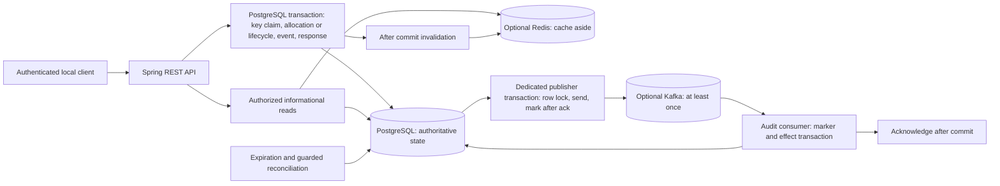
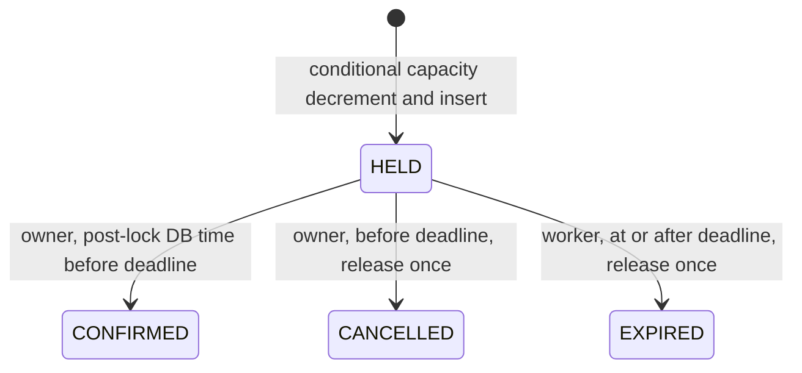

# Running and operating Atlas

Atlas is a Java 21 / Spring Boot 4.1.1 backend for allocating fixed capacity. PostgreSQL owns reservations, idempotency, expiration and event history. Optional Kafka delivers events at least once to a duplicate-safe audit consumer. Optional Redis caches informational reads.

All fifteen requested phases are implemented locally. This is a learning and demonstration project; external deployment and production readiness are outside the handoff. [Final review and evidence](VERIFICATION.md#phase-15), [learning guide](LEARNING_GUIDE.md), [API contract](APP_API_FLOW.md), [schema](BACKEND_SCHEMA.md), and [technical decisions/version pins](TRD.md).

## Prerequisites

- PowerShell 7, JDK 21, Docker Desktop's Linux engine and Docker Compose. Maven is supplied by the wrapper (3.9.11).
- Network access for the first dependency/image downloads. All infrastructure and k6 images have immutable digest pins.
- Spring Boot 4.1.1, PostgreSQL 17.11, Kafka 4.3.1, Redis 8.4.7 and k6 2.3.0 were verified in the linked phase evidence. These are dated compatibility checks, not a promise about future support windows.

```powershell
# Run from your cloned atlas directory.
# Adjust the installation path if your JDK differs.
$env:JAVA_HOME='C:\path\to\jdk-21'
New-Item -ItemType Directory -Force .tools/java-sockets | Out-Null
# This host needs the workaround below. Preserve unrelated JVM flags if you have any.
$socketPath=Join-Path (Get-Location) ".tools/java-sockets"
$env:JAVA_TOOL_OPTIONS="-Djdk.net.unixdomain.tmpdir=$socketPath"
# Needed only if this terminal cannot already find Docker:
# Ensure the Docker CLI is on your PATH.
.\mvnw.cmd --version
docker version
docker compose version
```

The Windows socket workaround applies to host Java/Maven, not Linux app containers. No global OS/JDK setting is changed.

## Build and verify (PowerShell)

```powershell
.\mvnw.cmd -B -ntp verify
```

This runs all Surefire unit and Failsafe integration tests against real disposable PostgreSQL/Kafka/Redis infrastructure. Missing Docker fails acceptance; `test` alone omits integration tests. Logs/reports are under `target`, with retained phase evidence under `docs/evidence`. For one suite use `'-Dit.test=FailureRecoveryIT'` or another existing `*IT` class. `-DskipTests package` is a compilation/package check and provides no test evidence.

The wrapper defaults to `.m2`; optional `MAVEN_USER_HOME` relocates wrapper files, and `-Dmaven.repo.local=<path>` relocates dependencies. This workspace's executed commands use ignored `.tools` caches. Build before using the app container: its Dockerfile copies `target/atlas-0.1.0-SNAPSHOT.jar` and does not run Maven.

## Start PostgreSQL and the local application

Preserve an existing `.env`. Create one only when absent:

```powershell
if (-not (Test-Path .env)) { Copy-Item .env.example .env }
```

Set `POSTGRES_PASSWORD` and all three `ATLAS_LOCAL_*_PASSWORD` values privately. Local passwords must be nonblank and at most 72 UTF-8 bytes. The template has no credential defaults; `.env` is ignored. Changing the file does not rotate credentials already initialized in an existing PostgreSQL volume.

Start the container API with PostgreSQL:

```powershell
docker compose config --quiet
docker compose up -d --wait postgres
docker compose --profile app up -d --build app
# App startup is asynchronous; use your SERVER_PORT if customized.
$healthUrl='http://127.0.0.1:8080/actuator/health'
$deadline=[DateTime]::UtcNow.AddSeconds(90); $up=$false
do {
    try { $up=(Invoke-RestMethod $healthUrl -TimeoutSec 3).status -eq 'UP' } catch { $up=$false }
    if (-not $up) { Start-Sleep -Milliseconds 500 }
} while (-not $up -and [DateTime]::UtcNow -lt $deadline)
if (-not $up) { throw 'Application health did not become UP within 90 seconds; inspect app logs' }
# Expected: UP. This same bounded readiness check is executed by the handoff demo.
```

The app binds inside the container; published ports bind only to host loopback. It depends on healthy PostgreSQL. Health verifies application/database and incomplete-idempotency detection; it does not prove Kafka delivery or Redis availability. Inspect startup failures with `docker compose --profile app logs app`.

To enable the optional components, set `ATLAS_KAFKA_ENABLED=true` and `ATLAS_REDIS_ENABLED=true` in `.env`, then:

```powershell
docker compose --profile kafka --profile redis up -d --wait kafka redis
docker compose --profile app --profile kafka --profile redis up -d app
```

Compose profiles start infrastructure; the app enable flags independently opt into integrations. Container Kafka uses `kafka:19092`, Redis uses `redis:6379`. A host JVM instead uses published localhost ports.

For host Java, stop the app container so the HTTP port is free. A host JVM does not automatically read `.env`. Export credentials and connection settings explicitly; adjust database/user/ports if customized:

```powershell
docker compose --profile app stop app
$env:SPRING_DATASOURCE_URL='jdbc:postgresql://127.0.0.1:5432/atlas'
$env:SPRING_DATASOURCE_USERNAME='atlas'
$env:SPRING_DATASOURCE_PASSWORD=[Net.NetworkCredential]::new('',(Read-Host 'PostgreSQL password from .env' -AsSecureString)).Password
$env:ATLAS_LOCAL_ALICE_PASSWORD=[Net.NetworkCredential]::new('',(Read-Host 'Alice password' -AsSecureString)).Password
$env:ATLAS_LOCAL_BOB_PASSWORD=[Net.NetworkCredential]::new('',(Read-Host 'Bob password' -AsSecureString)).Password
$env:ATLAS_LOCAL_ADMIN_PASSWORD=[Net.NetworkCredential]::new('',(Read-Host 'Admin password' -AsSecureString)).Password
$env:ATLAS_KAFKA_ENABLED='false'
$env:ATLAS_REDIS_ENABLED='false'
& "$env:JAVA_HOME\bin\java.exe" -jar target/atlas-0.1.0-SNAPSHOT.jar --spring.profiles.active=local
```

When opting host Java into Kafka/Redis, export the corresponding flags plus `SPRING_KAFKA_BOOTSTRAP_SERVERS=localhost:<KAFKA_PORT>` and `ATLAS_REDIS_HOST=localhost` / `ATLAS_REDIS_PORT=<REDIS_PORT>`. Stop host Java with Ctrl+C. Ordinary `docker compose down` preserves named volumes. **Adding `--volumes` deletes persisted local data; use it only for an explicitly disposable project.** The handoff demo has separate guarded cleanup.

## Configuration reference

Application profiles are `local` (development Basic identity), `kafka` and `redis` (optional app integration), and test-only `test`. Combine optional profiles with `local`; outside `local` domain access is denied. There is no production identity/profile. Compose profiles are separately named `app`, `kafka`, `redis`.

| Variable | Default / bounds | Use |
| --- | --- | --- |
| JAVA_HOME / JAVA_TOOL_OPTIONS | Java 21 / host workaround above | Host JVM/Maven |
| SPRING_PROFILES_ACTIVE | No implicit profile | Select `local`, optionally `local,kafka,redis` |
| SERVER_ADDRESS / SERVER_PORT | 127.0.0.1 / 8080 | Host listener; Compose app binds 0.0.0.0 internally |
| SPRING_DATASOURCE_URL / USERNAME / PASSWORD | Required; local URL localhost:5432/atlas, user atlas; no password default | Host DB connection; use full `SPRING_DATASOURCE_USERNAME` |
| POSTGRES_DB / POSTGRES_USER / POSTGRES_PASSWORD | atlas / atlas / required | Compose initialization and app connection |
| POSTGRES_PORT / KAFKA_PORT / REDIS_PORT | 5432 / 9092 / 6379 | Host loopback mappings |
| ATLAS_LOCAL_ALICE_PASSWORD / BOB_PASSWORD / ADMIN_PASSWORD | All required; max 72 UTF-8 bytes | Full variable names start `ATLAS_LOCAL_` |
| ATLAS_HOLD_TTL_SECONDS | 300; 1-3600 | New persisted hold deadlines; existing deadlines stay fixed |
| ATLAS_EXPIRATION_ENABLED | true | Automatic expiry scheduling |
| ATLAS_EXPIRATION_POLL_MS / BATCH_SIZE | 1000; 100-60000 / 100; 1-100 | Full names start `ATLAS_EXPIRATION_`; fixed delay and candidate bound |
| ATLAS_KAFKA_ENABLED / PUBLISHER_ENABLED / CONSUMER_ENABLED | false / true / true | Full names start `ATLAS_KAFKA_` |
| SPRING_KAFKA_BOOTSTRAP_SERVERS | localhost:9092 on host | Compose app fixes internal kafka:19092 |
| ATLAS_KAFKA_POLL_MS / BATCH_SIZE | 1000; 100-60000 / 20; 1-100 | One transaction per event, bounded per poll |
| ATLAS_REDIS_ENABLED / HOST / PORT | false / localhost / 6379 | Full names start `ATLAS_REDIS_`; Spring Data host/port aliases supported |
| ATLAS_REDIS_CONNECT_TIMEOUT_MS / COMMAND_TIMEOUT_MS | 100 / 100; each 1-1000 | Separate Redis operation budgets |
| ATLAS_REDIS_FILL_BUDGET_MS | 1000; 1-1000 | Bound stale refill age; not a total HTTP timeout |
| ATLAS_RECOVERY_ENABLED | true | Reconciliation scheduling; retry policy remains active when disabled |
| ATLAS_RECOVERY_POLL_MS / BATCH_SIZE | 10000; 100-60000 / 100; 1-100 | Full names start `ATLAS_RECOVERY_` |
| ATLAS_RECOVERY_STUCK_MS | 60000; 1000-3600000 | Old/stuck finding threshold |
| ATLAS_RECOVERY_MAX_ATTEMPTS | 5; 1-20 | Recorded attempts per replay cycle |
| ATLAS_RECOVERY_BASE_DELAY_MS / MAX_DELAY_MS | 1000; 100-60000 / 60000; base through 300000 | Equal-jitter exponential retry |
| SPRING_DATASOURCE_HIKARI_MAXIMUM_POOL_SIZE / MINIMUM_IDLE | 10 / 1 | Optional Spring overrides; keep capacity/worker budgets aligned |

Canonical full settings are in [.env.example](../.env.example) and [application.yml](../src/main/resources/application.yml). Hikari acquisition/validation/startup budgets are 5/2/10 seconds; JDBC connect/socket budgets 5/15 seconds; PostgreSQL statement/lock budgets 10/5 seconds. The publisher has a separate max-two connection pool, 2-second acquisition, 12-second transaction and 15-second idle transaction budget. Broker request/delivery/wait budgets are 2/5/6 seconds; consumer synchronous commit is bounded to 3 seconds. These bound individual operations, not every end-to-end HTTP or recovery interval. Flyway validates V1-V5, never cleans/baselines automatically; JPA generates no schema and has no entity mappings. JDBC snapshots and DTOs are separate. Sessions use UTC; authoritative decisions use PostgreSQL time.

## Local identity and resource requests

| User | Stable UUID | Roles |
| --- | --- | --- |
| alice | 11111111-1111-4111-8111-111111111111 | USER |
| bob | 22222222-2222-4222-8222-222222222222 | USER |
| admin | 33333333-3333-4333-8333-333333333333 | USER, ADMIN |

Passwords are your environment values. This is localhost HTTP Basic, with no production TLS/account recovery/signup or browser session scheme. Client `userId`, `X-User-Id` or role fields never prove identity; unknown/protected DTO fields are rejected. Admin creates resources and manages its own reservations, with no foreign-owner bypass.

<a id="temporary-holds-phase-4-intermediate-api"></a>

## API examples

Use the current API after startup. `curl.exe --user <name>` prompts privately; generate a key once per intention and keep it for retries. The examples are reproduction instructions, not fabricated response logs. [Executed HTTP responses](VERIFICATION.md#phase-15) come from the automated demo using these same endpoints/bodies.

```powershell
$base='http://127.0.0.1:8080'
New-Item -ItemType Directory -Force .tools | Out-Null
'{"name":"Demo capacity","totalCapacity":10}' | Set-Content .tools/create-resource.json -Encoding utf8
$resourceKey=[guid]::NewGuid().ToString()
$resource=curl.exe --silent --show-error --fail-with-body --user admin --header "Idempotency-Key: $resourceKey" --header 'Content-Type: application/json' --data-binary '@.tools/create-resource.json' "$base/api/resources" | ConvertFrom-Json
$resourceId=$resource.id
curl.exe --user alice "$base/api/resources/$resourceId"
curl.exe --user bob "$base/api/resources/$resourceId/availability"
@{resourceId=$resourceId;quantity=3} | ConvertTo-Json -Compress | Set-Content .tools/hold.json -Encoding utf8
$holdKey=[guid]::NewGuid().ToString()
$held=curl.exe --silent --show-error --fail-with-body --user alice --header "Idempotency-Key: $holdKey" --header 'Content-Type: application/json' --data-binary '@.tools/hold.json' "$base/api/reservations" | ConvertFrom-Json
$reservationId=$held.id
# Matching retry returns original 201/body/Location plus Idempotency-Replayed: true.
curl.exe -i --user alice --header "Idempotency-Key: $holdKey" --header 'Content-Type: application/json' --data-binary '@.tools/hold.json' "$base/api/reservations"
curl.exe --user alice "$base/api/reservations/$reservationId"
curl.exe --user alice "$base/api/users/11111111-1111-4111-8111-111111111111/reservations?limit=20"
$confirmKey=[guid]::NewGuid().ToString()
curl.exe -i --user alice -X POST --header "Idempotency-Key: $confirmKey" "$base/api/reservations/$reservationId/confirm"
```

For cancellation, create a **different HELD reservation** before its deadline, then POST its `/cancel` URL with its own key and an empty body. Confirmation retains capacity; confirmed reservations cannot be cancelled in this version. Availability and cached reservation state are informational. Use PostgreSQL mutation responses/decisions for authorization and allocation, never cached availability.

| Request | Success / relevant failures |
| --- | --- |
| POST /api/resources | 201 Resource + Location; 400 invalid/key; 401 auth; 403 non-admin |
| GET /api/resources/{id} or /availability | 200; 400 malformed UUID; 404 resource missing |
| POST /api/reservations | 201 Reservation + Location; 400 invalid/key; 404 resource missing; 409 INSUFFICIENT_CAPACITY |
| GET /api/reservations/{id} | 200 owned read; 404 missing/foreign |
| GET /api/users/{userId}/reservations | 200 page; 403 foreign path; 400 limit/cursor |
| POST /api/reservations/{id}/confirm or /cancel | 200; 404 missing/foreign; 409 expired or invalid transition |

Names use Java strip(), nonblank <=120 UTF-16 code units, no NUL. Quantities/capacities are integers 1-2147483647. Unknown/duplicate fields, coercion, trailing JSON and nonempty confirm/cancel bodies are rejected. Listing uses an opaque `(createdAt,id)` cursor, default 20/max 100; concurrent inserts are not a frozen snapshot.

Errors are `{code,message,requestId,details}`; every attempt has a server-generated `X-Request-Id`. First error header/body IDs match; stored error replay keeps its original body ID and receives a new header ID. Four mutations require one ASCII `Idempotency-Key` matching `[A-Za-z0-9._:-]+`, length 1-128. Same caller/operation/key plus different canonical request is 409 IDEMPOTENCY_KEY_MISMATCH. Successful and deterministic domain 404/409 results are retained indefinitely; validation/auth/ownership/key mismatch and infrastructure failures are not newly stored. Retry uncertain 5xx/network outcomes with the same request/key and bounded backoff. A stored capacity conflict remains that original conflict even after capacity returns; use a new key only for a deliberate new attempt. Replayed creation may say HELD after current state becomes terminal; GET gives informational present state. [Complete API/state/error rules](APP_API_FLOW.md).

<a id="kafka-publication-and-audit-phase-10"></a>

## Architecture



Business transactions never call Kafka. Cache invalidation runs after commit and cannot undo success. Publisher send/mark and consumer DB/offset commits are independent, so duplicates are possible. One event per reservation transition has sequence 1/2 and a stable ID; there is no separate CapacityReleased event. Arrival can be out of sequence; the audit consumer is order independent. Future state projections need explicit sequence/gap handling. [Deep explanations](LEARNING_GUIDE.md#mechanisms-you-should-be-able-to-explain).

<a id="database-expiration-worker-phase-7"></a>

## Reservation state machine



Terminal states never transition again. Confirmation does not decrement again or release. Same-target terminal operations with a new key return existing state without effects; same-key retries replay the original response. At deadline equality an overdue HELD is ineligible immediately, even before its persisted EXPIRED state. Release occurs only when the worker transaction commits. Lock order is key claim -> one existing reservation -> resource if releasing -> event. New holds lock a resource and insert a previously invisible reservation. Workers use one reservation per transaction and SKIP LOCKED; polling/backlog/locks/outages can increase expiry lag without a fixed bound.

## Schema

| Table | Purpose / integrity boundary |
| --- | --- |
| resource | UUID, fixed total, available bounds, version/timestamps |
| reservation | Owner/resource/quantity, HELD/CONFIRMED/CANCELLED/EXPIRED, fixed deadline, terminal timestamps, sequence |
| idempotency_record | Unique caller/operation/key, canonical hash, original HTTP result; claim/mutation/result share commit |
| outbox_event | Stable event UUID, unique reservation/sequence, versioned envelope, PENDING/PUBLISHED/FAILED, retry/replay metadata |
| processed_event | Unique event/consumer claim |
| reservation_audit | One immutable effect per event/consumer, FK to marker |
| consumer_failure | Consumer/topic/partition/offset identity, payload hash, durable retry/failure/replay |

Committed invariant: `available_capacity + sum(quantity for all HELD and CONFIRMED) = total_capacity`. Overdue HELD still counts. CHECK/FK/unique constraints enforce row shape, bounds and relationships; application transactions enforce ownership, history, conservation, one-time release and response/event atomicity. Privileged ad hoc SQL can violate cross-table guarantees. [Columns, indexes, constraints, ER diagram and migrations](BACKEND_SCHEMA.md).

V3 deliberately refuses an existing nonempty pre-outbox reservation dataset; stop old writers and preserve data, then design an explicit historical import if needed. It does not fabricate history. V4/V5 preserve existing V3+ data. Never reset non-disposable data to bypass migration activation; do not mix old/new writers. Idempotency, outbox, audit, failure records and Kafka logs have indefinite retention; storage/privacy lifecycle remains deferred.

<a id="optional-redis-caching-phase-11"></a>
<a id="retries-and-reconciliation-phase-12"></a>

## Recovery procedures

Read-only inspection (replace atlas role/database if customized):

```powershell
Get-Content -Raw scripts/reconcile.sql | docker compose exec -T postgres psql -X -U atlas -d atlas -v ON_ERROR_STOP=1 -v stuck_ms=60000 -v limit=100
docker compose exec -T postgres psql -U atlas -d atlas -c "SELECT event_id,status,attempt_count,next_attempt_at,failed_at,last_error,replay_count FROM outbox_event WHERE status<>'PUBLISHED' ORDER BY next_attempt_at,event_id LIMIT 100;"
docker compose exec -T postgres psql -U atlas -d atlas -c "SELECT consumer_name,topic,partition,record_offset,event_id,status,attempt_count,next_attempt_at,last_error,replay_count FROM consumer_failure WHERE status<>'RESOLVED' ORDER BY updated_at LIMIT 100;"
docker compose --profile kafka exec -T kafka /opt/kafka/bin/kafka-consumer-groups.sh --bootstrap-server localhost:19092 --describe --group atlas.reservation-audit.v1
```

Kafka outage: HTTP mutations can commit to PostgreSQL while PENDING events accumulate. Restore the broker, then inspect outbox/audit/committed group lag. Equal-jitter retry cap is `min(maxDelay,baseDelay*2^(n-1))`, with an integer wait from half the cap through the cap. Default five recorded attempts become FAILED; the schedule is not a recovery SLA. Crash/send ambiguity can leave uncounted sends, so budget limits cover recorded attempts. Publisher successes also count an attempt.

Redis outage: reads fall back to PostgreSQL and committed mutations remain successful. Restore Redis and observe `cached`/`observedAt`; existing TTLs are 2 seconds for availability and 5 seconds for owned reservation state, capped by HELD lifetime. A refill can race invalidation, so working expiry/fill budgets bound possible staleness to up to 3/6 seconds after mutation; perfect coherence is not promised.

PostgreSQL failure: durable new mutations fail with sanitized 503/500 rather than succeed falsely. Restore connectivity and retry the original key/request; inspect health/incomplete claims. Pending state survives app restart. Reconciliation inspects counts/details in one repeatable-read snapshot, then independently rechecks locked reservation/resource integrity before expiry repair. It never assigns capacity from a stale sum, invents missing events or erases dedupe markers. Corruption findings require investigation.

Controlled replay of FAILED work:

1. Record exact failed identity, payload hash/event ID, `replay_count`, diagnostic and cause in private operator evidence. Stop affected app consumers/workers and restore the dependency or deploy an independently reviewed fix.
2. Outbox replay preserves event ID/payload; consumer replay preserves topic/partition/offset. The functions require the inspected expected count and a fixed reason: DEPENDENCY_RECOVERED, FIX_DEPLOYED or OPERATOR_VERIFIED.
3. Use the actual inspected values (the UUID/offset/count below are placeholders, not executed output):

```powershell
docker compose --profile app stop app
# Substitute the inspected UUID and expected replay count. Do not replay PUBLISHED rows.
docker compose exec -T postgres psql -U atlas -d atlas -c "SELECT atlas_replay_outbox('EVENT_UUID'::uuid, EXPECTED_REPLAY_COUNT, 'DEPENDENCY_RECOVERED');"
# Substitute original failed record identity and expected replay count; do not reset offsets.
docker compose exec -T postgres psql -U atlas -d atlas -c "SELECT atlas_replay_consumer('atlas.reservation-events.v1', 0, ORIGINAL_OFFSET, EXPECTED_REPLAY_COUNT, 'DEPENDENCY_RECOVERED');"
docker compose --profile app start app
```

True means one accepted replay, false means the row/count no longer matched. Reusing the old expected count is a no-op. Restart and verify the same stable ID has one audit effect, outbox progress and committed group offsets; retain operator evidence. A malformed immutable poison record cannot be repaired by changing its payload or silently skipping it. The local single-partition listener stops on failure; it automatically restarts when durable RETRY_WAIT is due, stays stopped on FAILED, and holds later records behind the failing one. Latest replay metadata is not a full operator audit trail. [Function contracts and tested replay cases](BACKEND_SCHEMA.md#phase-12-retry-and-recovery-schema), [RecoveryIT evidence](VERIFICATION.md#phase-12).

For stuck active publisher locks, inspect `pg_stat_activity`/`pg_locks`, verify the exact owning app/backend and transaction age, and stop that worker gracefully. Do not clear a live row's lock/claim or terminate an unverified backend. Crash/disconnect rolls back and releases row locks; a later worker uses the same ID. Incomplete committed idempotency or missing audit/history is corruption requiring investigation, not permission to delete the record. No supported automated repair for those cases is claimed.

<a id="failure-and-recovery-suite-phase-13"></a>

## Verified normal and failure demo

Run from the prepared workspace with a built JAR and Docker. Use a new session ID:

```powershell
.\scripts\handoff\demo.ps1 -SessionId p15-reproduce-001
```

The script merges the normal Compose file with an isolation-only override, generates private credentials/free loopback ports, creates a fresh project, verifies host JAR startup and container startup, and records real HTTP/SQL observations. The flow creates capacity 10, confirms Alice's 3 units, cancels Bob's 2, discards a committed response body and replays without an extra hold, pauses Kafka while a hold commits, records a retry and restarts with pending work, stops/restarts Redis while cancellation/fallback succeed, then demonstrates overdue HELD with both workers disabled and EXPIRED after restart. The short-expiry segment uses a documented 3-second TTL only for the new demonstration hold; defaults are restored to 300 seconds. Final available capacity is 7, with confirmed quantity 3; all events have one audit effect.

The lost-body demo receives HTTP headers but reads zero response body bytes; it does not simulate every possible network failure. Phase 13 has the broader deterministic commit/ack failure suite. Poll/recovery deadlines are bounded; passed deadline versus persisted state is deliberately observable. Detailed settings, HTTP responses, DB snapshots and full logs are in [Phase 15 evidence](VERIFICATION.md#phase-15).

Only matching project/session-labelled demo containers and volumes are removed. Failure leaves logs/private volumes with the app stopped. After diagnosis, guarded cleanup is:

```powershell
.\scripts\handoff\demo.ps1 -SessionId p15-reproduce-001 -CleanupOnly
```

This deletes only that disposable project, not the ordinary Atlas database. `-SkipHostCheck` exists for container-only reproduction but is **not** the complete Phase 15 startup acceptance command.

## Tests and evidence

| Property | Reproduce / retained evidence |
| --- | --- |
| Fresh schema and upgrades/constraints | SchemaIT; [Phase 2](VERIFICATION.md#phase-2) and later migration suites |
| Identity/validation/owned reads | ResourceApiIT, ReservationHoldIT; [Phases 3](VERIFICATION.md#phase-3)/[4](VERIFICATION.md#phase-4) |
| Exact capacity-10 concurrency outcomes | AllocationConcurrencyIT; [Phase 5](VERIFICATION.md#phase-5) |
| Lifecycle and expiry races | ReservationLifecycleIT, ExpirationIT; [Phases 6](VERIFICATION.md#phase-6)/[7](VERIFICATION.md#phase-7) |
| Concurrent claim/replay, rollback, lost response | IdempotencyIT; [Phase 8](VERIFICATION.md#phase-8) |
| Atomic event/state and duplicate-safe delivery | OutboxIT, MessagingIT; [Phases 9](VERIFICATION.md#phase-9)/[10](VERIFICATION.md#phase-10) |
| Cache outage/refill and core correctness without Redis | CacheIT; [Phase 11](VERIFICATION.md#phase-11) |
| Backoff/exhaustion/replay, guarded snapshot reconciliation | RecoveryIT; [Phase 12](VERIFICATION.md#phase-12) |
| Eight real infrastructure failure/recovery boundaries | FailureRecoveryIT; [Phase 13](VERIFICATION.md#phase-13) |
| Reproducible measured k6 scenarios | [Load instructions](../scripts/load/README.md), [Phase 14 results](VERIFICATION.md#phase-14) |
| Final startup/demo, review and full regression | [Phase 15 ledger](VERIFICATION.md#phase-15) |

Phase 14 recorded 3,769 measured requests, 557 expected conflicts, no unexpected failures, and 23.42-25.76 requests/s under recorded local limits. Spike/retry publication p95 approached 17 seconds; their queues drained within the 60-second bound. Success/conflict latency is separate; connection/backlog peaks are sampled. This is one short shared-host run per workload, not saturation, a supported user count or production SLO. Raw data and exact versions/commands are preserved; do not repeat benchmark numbers without their configuration.

## Limitations and final handoff

Completed implementation/verification and unresolved/deferred work are separate in the [seven-document review](VERIFICATION.md#phase-15). Existing Micrometer meters are process-local; only minimal health is exposed. Success request logging, uniform JSON logs, public/protected metric export, distributed tracing and operational dashboards are unresolved planning aspirations, explicitly deferred here. Health is not an event delivery guarantee.

This local v1 has fixed single-resource capacity, retained confirmed allocations, development Basic identity, one Kafka partition/consumer concurrency, indefinite storage, bounded-stale cache and no strict event arrival ordering, expiry fairness or exactly-once transport guarantee. Backup/restore, process/host power loss, multi-region/production HA/security and large-scale saturation are not established. No external deployment was performed.

Codex wrote/reviewed the implementation and ran the retained checks. Your personal review, execution and ability to explain/modify the code are **NOT RECORDED**; generated explanations are study material. [Learning and evidence-backed claim gates](LEARNING_GUIDE.md#ownership-of-work-and-claim-gates) distinguish these. Final handoff stops here.
